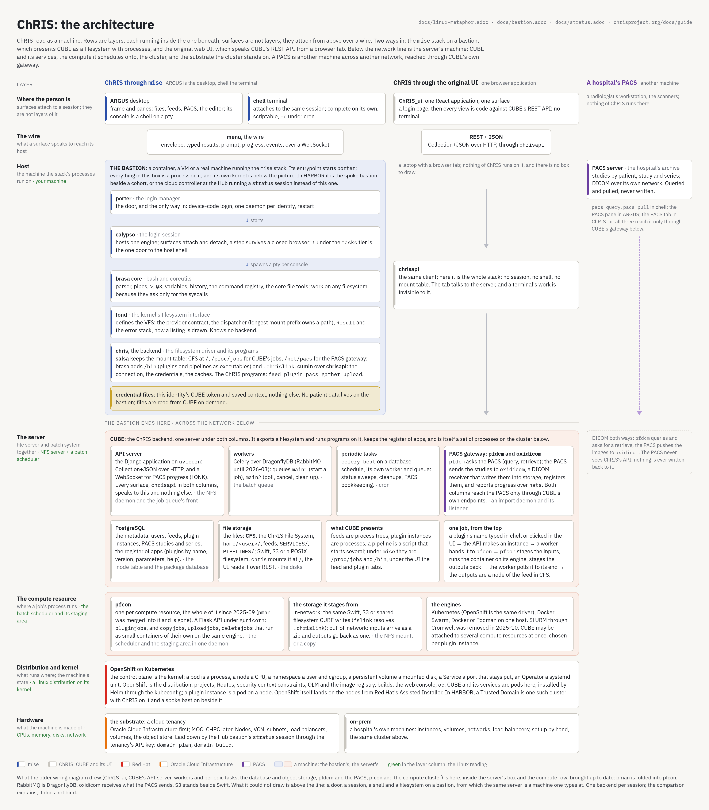

= ChRIS as a machine
:toc: left
:toclevels: 2
:sectnums:
:sectanchors:
:icons: font

== Abstract

ChRIS read as a machine, whole: the two ways in, the server they both end at, and what the server stands on. The figure is the stack figure of <<../linux-metaphor.adoc#,linux-metaphor.adoc>> with the CUBE card opened: rows are layers, each running inside the one beneath; surfaces are not layers and attach from above over a wire; the bastion's box ends at the network line, and below it is the server's machine. The companion figure, <<cube.adoc#,cube.adoc>>, draws the same server as blocks. <<overview.adoc#,overview.adoc>> collects every architecture figure in one place.

[[figure]]
== The figure

The source is `docs/images/chris-as-a-machine.html`, rendered at 1680 CSS pixels and device scale 2; edit the HTML and re-render rather than the PNG.

[[above]]
== Above the line: two ways in

The left column is the mise stack on a bastion, as linux-metaphor.adoc reads it: `porter` the login manager, `calypso` the session, `brasa` the shell and coreutils, `fond` the kernel's filesystem interface, and the `chris` backend as the filesystem driver, with `salsa` keeping the mount table (CFS at `/`, `/proc/jobs` for CUBE's jobs, `/net/pacs` for the PACS gateway) and `cumin` over `chrisapi` holding the connection. ARGUS is the desktop and chell the terminal; both attach over the wire, `menu`. The bastion holds this identity's CUBE token and nothing else; no patient data lives on it.

The right column is the original ChRIS UI: one React application in a browser tab that speaks CUBE's REST API through `chrisapi`. There is no session, no shell and no mount table, so there is no box to draw; the wire goes straight down to the server, and a terminal's work is invisible to it.

The PACS column is a hospital's archive, another machine on another network. Both columns reach it only through CUBE's own gateway, never directly.

[[below]]
== Below the line: the server's machine

*CUBE* is the file server and the batch system together, one server under both columns. The API server is the Django application on `uvicorn`: Collection+JSON over HTTP and a WebSocket for PACS progress (LONK). Workers are Celery over DragonflyDB (RabbitMQ until 2026-03), with `main1` starting jobs and `main2` polling, cancelling and cleaning up; `celery beat` keeps a database schedule on a worker and queue of its own. PostgreSQL holds the metadata, including the register of apps; the file storage, Swift, S3 or a POSIX filesystem, holds CFS. The PACS gateway is two services: `pfdcm` asks the PACS (query, retrieve) and `oxidicom` receives what the PACS sends, writes it into storage, registers it and reports progress over `nats`.

*The compute resource* is `pfcon`, one per resource and the whole of it since 2025-09, when `pman` was merged into it. It is a Flask API under `gunicorn` whose `pluginjobs` run the plugin's container and whose `copyjobs`, `uploadjobs` and `deletejobs` run as small containers of their own on the same engine. In-network it stages from the same Swift, S3 or shared filesystem CUBE writes; out-of-network the inputs arrive as a zip and the outputs go back as one. The engines are Kubernetes (OpenShift is the same driver), Docker Swarm, and Docker or Podman on one host; SLURM through Cromwell was removed in 2025-10.

*OpenShift on Kubernetes* is the distribution on its kernel: CUBE and its services are pods here, installed by Helm through the kubeconfig, and a plugin instance is a pod on a node. OpenShift lands on the nodes from Red Hat's Assisted Installer. *The substrate* is a cloud tenancy, Oracle Cloud Infrastructure first, laid down by the Hub bastion's `stratus` session, or a hospital's own machines.

[[sources]]
== What the figure was checked against

The server rows were read from the repositories as of 2026-10-25: pfcon (pman merged in #149, 2025-09-25; Cromwell and OpenShift modules removed 2025-10-10; sync and async op jobs 2026-03-26; S3 2026-04-02) and ChRIS_ultron_backEnd (DragonflyDB for RabbitMQ 2026-03-25; oxidicom service 2026-02-04; async pfcon 2026-03-26; S3 storage backend 2026-04-02; Django 6.0 on uvicorn 2026-09-16). The Linux glosses in the layer column are the comparison's, not the code's.
