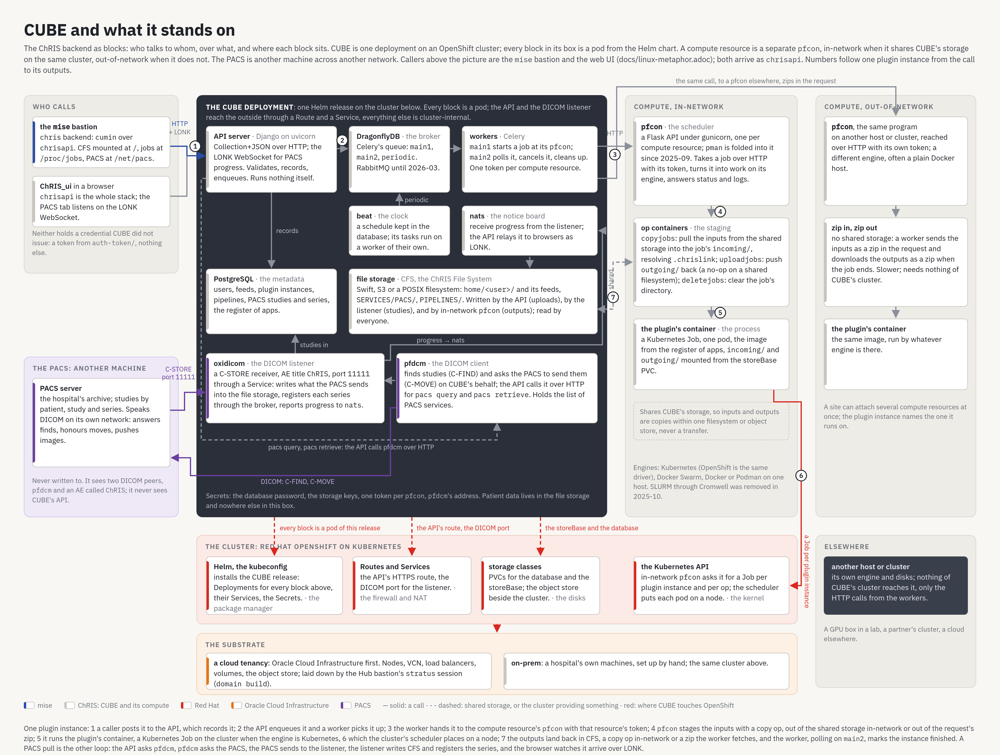

= CUBE and what it stands on
:toc: left
:toclevels: 2
:sectnums:
:sectanchors:
:icons: font

== Abstract

The ChRIS backend as blocks: who talks to whom, over what, and where each block sits. A stack says what runs inside what; most of what matters about CUBE's lower levels is the other kind of fact, that the API and its workers are peers around a broker, that a compute resource is a separate service across a boundary, that the PACS path is a loop, and that one storage is shared by three writers. This figure draws those. <<chris-as-a-machine.adoc#,chris-as-a-machine.adoc>> is the same server as layers; <<overview.adoc#,overview.adoc>> collects every architecture figure.

[[figure]]
== The figure

The source is `docs/images/cube-and-what-it-stands-on.html`, a fixed 1680 by 1270 canvas with the wires as an SVG overlay; edit the HTML and re-render rather than the PNG. Solid wires are calls, dashed wires are shared storage or the cluster providing something, red wires are where CUBE touches OpenShift, and the numbers follow one plugin instance.

[[deployment]]
== The CUBE deployment

One Helm release on the cluster; every block is a pod. The API server (Django on `uvicorn`) validates, records and enqueues, and runs nothing itself; it also serves the LONK WebSocket that relays PACS progress to browsers. DragonflyDB is Celery's broker with the queues `main1`, `main2` and `periodic`; the workers start a job at its `pfcon` on `main1` and poll, cancel and clean up on `main2`, one token per compute resource; `beat` keeps the schedule in the database and its tasks run on a worker of their own. PostgreSQL holds the metadata. The file storage, Swift, S3 or a POSIX filesystem, holds CFS and is written by the API (uploads), by the DICOM listener (studies) and by an in-network `pfcon` (outputs), and read by everyone. The PACS gateway is `oxidicom`, a C-STORE receiver with AE title `ChRIS` on port 11111 that writes what the PACS sends into storage, registers each series through the broker and reports progress to `nats`; and `pfdcm`, the DICOM client that finds studies and asks the PACS to send them when the API calls it for `pacs query` and `pacs retrieve`. The box's secrets are the database password, the storage keys, one token per `pfcon` and `pfdcm`'s address; patient data lives in the file storage and nowhere else in the box.

[[callers]]
== Who calls, and the PACS

The callers are the mise bastion (the `chris` backend, `cumin` over `chrisapi`, with CFS at `/`, jobs at `/proc/jobs` and the PACS at `/net/pacs`) and ChRIS_ui in a browser, whose PACS tab listens on LONK. Neither holds a credential CUBE did not issue. The PACS is the hospital's archive on its own network; it sees two DICOM peers, `pfdcm` and an AE called `ChRIS`, is never written to, and never sees CUBE's API.

[[compute]]
== The compute resources

`pfcon` is a Flask API under `gunicorn`, one per compute resource; `pman` is folded into it since 2025-09. It takes a job over HTTP with its token, turns it into work on its engine, and answers status and logs. Its op containers do the staging: `copyjobs` pull the inputs from the shared storage into the job's `incoming/`, resolving `.chrislink`; `uploadjobs` push `outgoing/` back, a no-op on a shared filesystem; `deletejobs` clear the job's directory. The plugin's container is a Kubernetes Job, one pod, the image from the register of apps, with `incoming/` and `outgoing/` mounted from the storeBase volume.

An in-network `pfcon` shares CUBE's storage and runs on the same cluster, so inputs and outputs are copies within one filesystem or object store, never a transfer. An out-of-network `pfcon` is the same program on another host or cluster, reached over HTTP with its own token, with no shared storage: the worker sends the inputs as a zip in the request and downloads the outputs as a zip when the job ends. A site can attach several compute resources at once; the plugin instance names the one it runs on. The engines are Kubernetes (OpenShift is the same driver), Docker Swarm, and Docker or Podman on one host.

[[openshift]]
== Where CUBE touches OpenShift

Four places, drawn red:

* *Helm through the kubeconfig* installs the CUBE release: a Deployment for every block, their Services, the Secrets.
* *Routes and Services* expose the API's HTTPS route and the DICOM port for the listener.
* *Storage classes* back the database and the storeBase with persistent volume claims; the object store sits beside the cluster.
* *The Kubernetes API* is where an in-network `pfcon` asks for a Job per plugin instance and per op; the cluster's scheduler puts each pod on a node.

The cluster stands on the substrate: a cloud tenancy, Oracle Cloud Infrastructure first, laid down by the Hub bastion's `stratus` session (<<../stratus.adoc#,stratus.adoc>>), or a hospital's own machines set up by hand. An out-of-network compute resource stands elsewhere, on its own engine and disks; nothing of CUBE's cluster reaches it, only the workers' HTTP calls.

[[job]]
== One plugin instance

. A caller posts it to the API, which records it.
. The API enqueues it and a worker picks it up.
. The worker hands it to the compute resource's `pfcon` with that resource's token.
. `pfcon` stages the inputs with a copy op, out of the shared storage in-network or out of the request's zip.
. It runs the plugin's container, a Kubernetes Job on the cluster when the engine is Kubernetes.
. The cluster's scheduler places the pod on a node.
. The outputs land back in CFS, a copy op in-network or a zip the worker fetches, and the worker, polling on `main2`, marks the instance finished.

A PACS pull is the other loop: the API asks `pfdcm`, `pfdcm` asks the PACS, the PACS sends to the listener, the listener writes CFS and registers the series, and the browser watches it arrive over LONK.

[[open]]
== Not verified in the code

* Whether the DICOM port is a Route, a NodePort or a LoadBalancer Service on OpenShift; the compose file publishes it directly.
* The split between persistent volume claims and the object store per deployment.
* The box's secrets list is a framing; CUBE stores a `compute_auth_token` per compute resource, which is verified.
