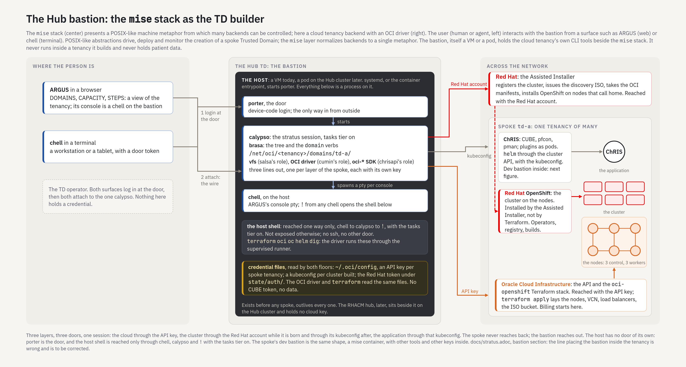

= The bastion: the mise stack as the Trusted Domain builder
:toc: left
:toclevels: 2
:sectnums:
:sectanchors:
:source-highlighter: rouge
:icons: font

== Abstract

A Trusted Domain (TD) is built from a *bastion*: one host that runs the mise stack and, beside it, the tools and the keys for one cloud. There are two bastions, and they are the same shape with different contents. The *Hub bastion* is the cloud controller: it sits at the Hub Trusted Domain, outside every tenancy it builds, holds the cloud keys, and lays a spoke Trusted Domain down in three layers, each through its own door. The *spoke bastion* is a development space inside a spoke's own cluster, next to that spoke's data; it holds a CUBE token and nothing that reaches beyond its project. This document draws the Hub bastion, names what runs where, and corrects two lines in <<stratus.adoc#bastion,stratus.adoc>> that placed the bastion inside the tenancy.

The companion documents are <<stratus.adoc#,stratus.adoc>> (the substrate backend the Hub bastion hosts) and <<linux-metaphor.adoc#,linux-metaphor.adoc>> (the machine metaphor every column of the figure is drawn in).

[[figure]]
== The Hub bastion

The mise stack (centre) presents a POSIX-like machine metaphor from which many backends can be controlled; here a cloud tenancy backend with an OCI driver (right). The user, human or agent (left), interacts with the bastion from a surface such as ARGUS (web) or chell (terminal). POSIX-like abstractions drive, deploy and monitor the creation of a spoke Trusted Domain; the mise layer normalizes backends to a single metaphor. The bastion, itself a VM or a pod, holds the cloud tenancy's own command-line tools beside the mise stack. It never runs inside a tenancy it builds and never holds patient data.

Read column by column.

[[person]]
=== Where the person is

Two surfaces, one session. ARGUS in a browser shows DOMAINS, CAPACITY and STEPS, a view of the tenancy; its console is a chell running on the bastion under a pty (#1125). chell in a terminal runs on a workstation or a tablet with a door token (#925). Both do the same two things in the same order: log in at the door, then attach to the one calypso over the wire. One calypso, many surfaces; nothing on the person's side holds a credential or runs a command.

[[host]]
=== The host

The bastion is a host: a VM today (the operator's workstation, or titan), a container on the Hub cluster once the Hub Trusted Domain is itself an OpenShift cluster. Everything in the centre column is a process on that host, and the lineage is fixed:

* *init starts porter.* systemd on a VM; the container entrypoint in a pod. porter is the door, and the only way in from outside.
* *porter starts calypso*, one per identity, on its berth.
* *calypso spawns a pty per console*: ARGUS's console is a chell on one of them.

The host has no door of its own. There is one path to its shell, and it is drawn in the figure: chell, through porter, to calypso, and `!` under the `tasks` tier opens the host shell. No ssh, no `oc rsh`, no other door is part of the design. A shell appears only when that path opens one, and the tools in it are the cloud's: `terraform`, `oci`, `oc`, `helm`, `dig`. The driver runs those same tools itself through the supervised runner (<<stratus.adoc#tasks,stratus.adoc>>), so a person and a step reach the host the same way and see the same files.

The credential files are on the host and are read by both floors: `~/.oci/config` holds an API key per spoke tenancy, a kubeconfig exists per cluster the bastion built, and the Red Hat token lives under the domain's state. The OCI driver inside calypso and `terraform` in the shell read the same files; nothing is copied out, and no CUBE token and no patient data are anywhere on the host.

[[session]]
=== The session: the same trio as ChRIS

calypso here hosts a stratus session with the `tasks` tier on. brasa supplies the tree and the `domain` verbs; the tenancy is mounted at `/net/oci/<tenancy>/`, and a spoke is a folder under `domains/`. Below brasa the stratus package repeats the ChRIS backend's three roles with other names: the fond providers in `vfs/` play salsa's role, `CloudDriver` and its OCI implementation in `cloud/` play cumin's role, and Oracle's per-service `oci-*` SDK packages play chrisapi's role. "Driver" in this document is that code of ours; the cloud's own API and Terraform stack are the thing it drives.

[[doors]]
=== Three layers, three doors

A spoke Trusted Domain is three layers, and the session reaches each through its own credential. The figure draws them as three lines leaving calypso:

[cols="1,2,3",options="header"]
|===
| Door | Target | What passes through it
| the API key | Oracle Cloud Infrastructure: the API, and the `oci-openshift` Terraform stack | `terraform apply` lays the nodes (three control, three workers), the VCN, subnets, load balancers, volumes and the bucket that holds the discovery ISO. Billing starts here.
| the Red Hat account | Red Hat's Assisted Installer | registers the cluster, issues the discovery ISO the bastion uploads to the bucket, takes the OCI manifests, and installs OpenShift on the nodes as they boot from the ISO and call home. OpenShift lands on the nodes from Red Hat's side, not from Terraform.
| the kubeconfig | the cluster API of the OpenShift just built | `helm` and `oc` deploy ChRIS; afterwards the Kubernetes driver reads the cluster through the same file.
|===

The spoke reads bottom up as a machine: Oracle's API lays the nodes; OpenShift is the cluster on those nodes; ChRIS is the application on that cluster. The spoke never reaches back; the bastion reaches out, through the cloud API before the cluster exists and through its kubeconfig after.

[[posture]]
=== Posture

* The Hub bastion runs *outside* every tenancy it builds. It exists before any spoke and outlives every one. A Hub bastion that is a pod on the Hub cluster is still outside each spoke: the Hub cluster is not a spoke.
* It holds cloud keys and no cluster-management role. The RHACM hub, when it comes (<<stratus.adoc#fleet,stratus.adoc>>), sits beside it on the Hub cluster, holds cluster management and no cloud key, and spoke agents pull from it.
* There is no scheduler in the picture. A schedule, if one is wanted, is `chell -c` under cron on the host: a shell line, not a component.
* There is no instance principal. The bastion never runs inside a tenancy, so its identity is the key file, as <<stratus.adoc#identity,stratus.adoc>> describes.

[[spoke]]
== The spoke bastion

Inside a spoke Trusted Domain the bastion is a development space: a Linux container with the tools, running in its own project on the spoke's cluster, next to the spoke's data. It is the same shape as the Hub bastion, a mise container, with other contents:

* the mise stack: porter as the door, calypso hosting *this* Trusted Domain's ChRIS session with the `tasks` tier on, chell as the console;
* a tool image: compilers, `podman`, `chris_plugin`, `pfdo`, `hostlib`, an editor;
* the keys: a CUBE token for this Trusted Domain and a kubeconfig scoped to this project, to build. No cloud key, no other Trusted Domain.

Development code lands and runs here. `plugin build` pushes an image to the cluster's internal registry; `plugin register` lands it in this CUBE's register of apps over the CUBE API; a run then happens on the data beside it, staged by pfcon. The Trusted Domain's data is mounted into the container read-only and written only through CUBE. Nothing leaves; the space is destroyed with the Trusted Domain.

The development space is not a new backend. It is a host for the ChRIS session, not a world to mount; it would become a backend only if a tree of its own emerged, which would reopen the cross-backend question #977 deferred. OpenShift Dev Spaces ships this shape as a workspace container per developer; whether the spoke bastion is that or a plain Deployment with our image is an implementation choice, and the plain one is smaller. Its figure follows the Hub figure's conventions and is drawn when the space is built.

[[corrections]]
== What this corrects

Two lines in stratus.adoc placed the bastion inside the tenancy it builds: the bastion section's "later a small instance inside the tenancy, using an instance principal", and the open item "the bastion inside the tenancy". Both are withdrawn by this document. The bastion is at the Hub, outside; the thing inside a Trusted Domain is the development space above, and it holds no cloud credential.

[[open]]
== Open

* The Hub bastion as a container on the Hub cluster: its entrypoint, how the key files arrive (mounted Secrets), and who may reach its porter.
* The spoke bastion's figure, and whether it is OpenShift Dev Spaces or a plain Deployment.
* One image family for both bastions, or two.
