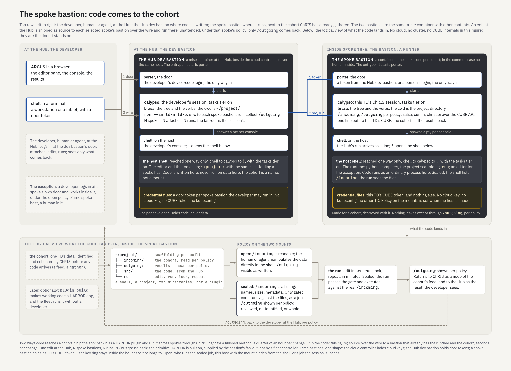

= The dev bastion: a coding surface over a cohort
:toc: left
:toclevels: 2
:sectnums:
:sectanchors:
:source-highlighter: rouge
:icons: font

== Abstract

HARBOR is a fleet of Trusted Domains (TDs), each an OpenShift cluster on its own cloud tenancy holding data that may not move. Analysis across the fleet therefore means moving code to data, and development means doing so at the cadence of a developer's loop, seconds per change, not the cadence of a release. This document describes the *dev bastion*: a mise container placed next to a cohort inside a spoke TD, into which code written at the Hub is shipped as source and run under the spoke's policy, with only `/outgoing` returning. It states what the dev bastion is, how it works, and why its policy is shaped as it is. The design is one mechanism with two postures: in the common case the spoke bastion is a runner with no human inside, driven from a Hub dev bastion; in the exception a developer logs in at the spoke's own door and works inside it. The policy on the two mounts, `/incoming` and `/outgoing`, is a property of the spoke set when the bastion is made, and it is what makes the mechanism safe to use with agents as well as people.

The companion documents are <<bastion.adoc#,bastion.adoc>> (the three bastions and the Hub cloud controller), <<redhat-fl.adoc#,redhat-fl.adoc>> (what Red Hat ships against the primitive, and why the alternative of shipping an app is wrong for development), and <<stratus.adoc#,stratus.adoc>> (how a spoke TD is built).

[[problem]]
== The problem

[[primitive]]
=== Edit at one OpenShift, run in many

A multi-site study in HARBOR is one method applied to N cohorts, each inside its own TD. The primitive the work rests on is: a developer, human or agent, edits in one place and runs the same code in N places against N cohorts, with results coming back and raw data staying put. Without the primitive each TD is an island and the only way to analyse across sites is to pool data, which a TD forbids. <<redhat-fl.adoc#survey,redhat-fl.adoc>> records that no Red Hat product supplies the primitive: the fleet plane moves declared state, the workspace is pinned to its cluster, and the federated-learning patterns move one container and return one artifact.

[[cadence]]
=== The cadence problem

ChRIS already moves code to data: a plugin is a container, a cohort is a feed, a plugin instance runs on the cohort's node, and provenance is the feed itself. That path is right for a finished method. It is wrong for development. The smallest change rebuilds a container, pushes it to a registry, and waits for each spoke to pull and schedule it: a quarter of an hour for a `print()`. A developer's loop is edit, run, look, repeat, and it has to close in seconds. Development therefore needs a second path, in which the runtime is already in place next to the cohort and only the source moves.

[[constraints]]
=== The constraints that shape it

* *Data never crosses a TD boundary.* The developer may not be inside the TD, and the data may not come out to them.
* *An agent may be the developer.* Whatever the loop permits a human, it permits an agent; the design cannot rely on a person's discretion.
* *Credentials stay inside their boundary.* The person who builds TDs holds cloud keys; the person who writes code holds none; a spoke bastion holds its own TD's token and nothing that reaches another.
* *Every run is accountable.* What code ran on which cohort and produced which output is recorded; when results return to ChRIS they land as a node of the cohort's feed, so the record is the one ChRIS already keeps.
* *The loop must be a shell.* A developer, or an agent driving one, works in a terminal and an editor; the mechanism must present as one, not as a submission form.

[[what]]
== What it is

[[three]]
=== Three bastions, one shape

The figure's top row shows two of HARBOR's three bastions. All three are the same thing, a mise container (<<bastion.adoc#host,bastion.adoc>>): an entrypoint starts porter, porter starts calypso per identity, calypso spawns a pty per console, and the host shell is reached one way only, through chell, calypso and `!` under the `tasks` tier. They differ in contents and in key ring.

[cols="1,2,2,2",options="header"]
|===
| | Hub cloud controller | Hub dev bastion | Spoke bastion
| Where | the Hub TD, outside every spoke tenancy | the Hub TD, beside the controller, never the same host | inside a spoke TD, next to one cohort
| Session | stratus: the tenancy at `/net/oci` | the developer's: cwd `~/project/` | this TD's ChRIS: cwd the project directory, `/incoming` and `/outgoing` under policy
| Shell holds | `terraform`, `oci`, `oc`, `helm` | the editor and the toolchain | the runtime: python, compilers, the project scaffolding, `run`
| Key ring | a cloud API key per spoke, the Red Hat account, a kubeconfig per cluster | a porter door token per spoke bastion the developer may run in | this TD's CUBE token
| Holds | no CUBE token, no data | code, never data | one cohort, under policy; nothing of any other TD
| Exists | before any spoke, outlives all | one per developer | one per cohort, destroyed with it
|===

[[logical]]
=== The logical view

The dev bastion is a host with a shell, and what the code lands in is a directory on that host. Nothing about it is a plugin: no container per run, no CUBE scheduling, no plugin contract. The figure's lower band draws it:

* *The cohort* is identified and collected by ChRIS before any code arrives: a feed, a `gather`, one TD's data. The dev bastion never chooses data; it receives a cohort already chosen and already recorded.
* *The project directory* is `~/project/` with scaffolding pre-built: `incoming/` holding the cohort, `outgoing/` for results, `src/` for the code, and `run`. Code runs as an ordinary process in the shell, reading one directory and writing the other; those two directories are its whole data surface.
* *The policy on the two mounts* is one of two postures, open or sealed (<<policy>>), chosen when the bastion is made for the cohort.
* *The loop* is edit in `src`, `run`, look at `/outgoing`, repeat, in minutes. Under the sealed posture the run passes a gate and executes against the real `/incoming` while the shell sees only a listing.
* *The exit* is `/outgoing` returning to ChRIS as a node of the cohort's feed, and to the developer at the Hub as the result they see. Later, optionally, `plugin build` turns working code into a HARBOR app and the fleet runs it without a developer.

[[how]]
== How it works

[[hub-side]]
=== At the Hub

The developer logs in at the Hub dev bastion's door and attaches, from ARGUS or chell. Their session's working directory is `~/project/`, with the same scaffolding a spoke has; the cohort is a name here, not a mount, and no data is ever present. The shell holds the editor and the toolchain. `run --in td-a td-b` ships `src` to each named spoke's bastion, runs it there, and collects each `/outgoing`. One edit, N spokes, N attaches, N runs: the fan-out is the session's own, attaching to N calypsos through N doors, not a fleet controller's.

[[wire]]
=== Over the wire

For each spoke the Hub session holds a porter door token for that spoke's bastion, and nothing else about that spoke. It logs in at the door, attaches to the spoke bastion's calypso, lands `src` in the project directory through the `tasks` tier, and issues the run as a line. The spoke's calypso is a ChRIS session like any other; the run arrives as a line a chell could have typed, and the result is whatever the process wrote into `/outgoing`. Nothing about the transport is new to mise: it is the wire, a door, and the host-control tier, used N times.

[[spoke-side]]
=== In the spoke

The spoke bastion is a container in its own project on the spoke's cluster, one per cohort, made with the cohort and destroyed with it. Its entrypoint starts porter; in the common case no human is inside. Its calypso hosts this TD's ChRIS session with salsa, cumin and chrisapi over the CUBE API, and its one line out is to this TD's CUBE: the cohort in, the results back. Its key ring is this TD's CUBE token. It holds no cloud key, no kubeconfig and no `oc`: the cluster is the floor the container stands on, not a thing it operates, and the developer's code can neither see nor reach it.

[[chris-coupling]]
=== The coupling to ChRIS

ChRIS is on both ends of the loop and nowhere in the middle. It gathers the cohort, which is how `/incoming` comes to exist; it receives `/outgoing`, which becomes a node of the cohort's feed; and the feed is the provenance: this code, this cohort, this output, in order. The dev bastion adds no second record. When the code is finished, `plugin build` makes it a HARBOR app and `plugin register` lands it in a CUBE, and from then on ChRIS runs it the ordinary way.

[[exception]]
=== The exception

A developer may log in at a spoke's own door and work inside its bastion. Same host, a human in it, under the open posture. This is the case for code that cannot be written blind: exploratory analysis, a bug that only the data explains, a method whose first draft needs eyes on the files. It is the exception because it puts a person next to the data, and because it does not scale past one spoke at a time.

[[policy]]
== The policy, and why

[[postures]]
=== Two postures on two mounts

[cols="1,2,2",options="header"]
|===
| | open | sealed
| `/incoming` | readable; the human or agent reads and manipulates the data directly in the shell | a listing: names, sizes, metadata; the files themselves are reachable only by code that has passed the gate, run as a job
| who runs the code | the developer, in the shell | the run, against the real files, while the shell sees the listing
| `/outgoing` | visible as written | shown per policy: reviewed, de-identified, or whole
| who is inside | typically a person | typically nobody; the Hub drives
|===

[[why-mounts]]
=== Why policy is a property of the mounts

The policy is applied to two directories, set when the bastion is made for the cohort, and not changeable from inside. Three reasons:

* *Two directories are the whole data surface.* The code in the shell reaches the cohort through `/incoming` and leaves anything behind only through `/outgoing`. Governing those two mounts governs everything the code can do with data, with no new surface to audit.
* *It cannot be argued with.* A policy a developer can relax from the shell is a policy an agent can relax from the shell. Setting it at creation, by whoever makes the bastion for that cohort, keeps it out of the hands of the code that runs under it.
* *It composes with the cohort.* The data custodian decides, per cohort, how much a developer may see. Tying the posture to the bastion ties it to the cohort, not to the person, so the same developer gets different postures on different data, as they should.

[[why-sealed]]
=== Why sealed is the common case

* *Nobody is inside.* In the common case the spoke bastion runs code sent from the Hub, with no human present. A posture that assumes a person's judgment has nothing to attach to.
* *The developer may be an agent.* An agent driving the loop from the Hub must be able to iterate without being able to read patient data. Sealed gives it the listing, the run, and the policed output: enough to develop, not enough to exfiltrate.
* *Blind coding is ordinary.* Developers routinely write against a listing, a schema or a sample and judge by the output. Sealed is that practice, made real-time against the real cohort, with the data itself never on the developer's side of the shell.
* *The gate makes the run accountable.* Code that touches the files has passed an explicit check, so every run under sealed is a run of approved code on a named cohort, which is what a feed node records.

[[why-open]]
=== Why open exists

Some work cannot be done blind: the first look at a new cohort, a failure that only the data explains, a method whose assumptions need checking against real images. Open exists for that, and its two costs are visible by construction: a person is next to the data, and the output review is the only thing between the shell and the world. Open is the data custodian's call, per cohort, not the developer's.

[[why-outputs]]
=== Why outputs are reviewed

`/outgoing` is the only thing that leaves a TD, so it is where disclosure control lives. The three settings, reviewed, de-identified, or whole, map onto what the custodian will accept: a human airlock, an automatic transform, or trust. This is the same reasoning as a trusted research environment's output check, and it is why the figure draws the return path from `/outgoing` back to the Hub as a dashed line with "per policy" on it: the developer sees what the cohort's custodian allows them to see, and nothing in the loop depends on them seeing more.

[[why-keys]]
=== Why the key rings are disjoint

The cloud controller holds cloud keys and builds TDs; the Hub dev bastion holds door tokens and writes code; a spoke bastion holds its TD's token and runs code. No host holds two of these. A compromised Hub dev bastion can therefore do one thing: run code in the spoke bastions its tokens open, under those spokes' policies, which is the thing it is for. The policy holds even then, which is the point of putting it on the mounts and not in the Hub.

[[why-no-cluster]]
=== Why the spoke bastion knows nothing of its cluster

An earlier draft gave the spoke bastion `oc` and a project-scoped kubeconfig for building images. Withdrawn. The dev bastion's concern is a project directory over a cohort; the cluster, the registry and the cloud are the floor it stands on, built by the Hub controller through its own doors (<<bastion.adoc#doors,bastion.adoc>>). Giving the developer's code a view of the cluster widens the blast radius for no gain the loop needs; turning code into an image is `plugin build`'s job, later, and the image push rides the container's own identity, never a key a person holds.

[[why-provenance]]
=== Why provenance is free

Because the cohort is a feed and `/outgoing` becomes a node of it, every run under either posture is recorded by the mechanism ChRIS already has. Nothing is logged specially for the dev bastion, and nothing can run on the cohort outside that record. Reproducibility and audit fall out of the shape rather than being added to it.

[[related]]
== Related work

* *Trusted research environments and the Five Safes.* The dev bastion's postures are the Five Safes in mechanism: safe projects (a cohort is gathered and recorded before code arrives), safe people (a door token per spoke per developer), safe settings (a container next to the data, one path in), safe data (open or sealed `/incoming`), safe outputs (`/outgoing` reviewed, de-identified, or whole). What TREs do with a desktop and an airlock, this does with a shell and two mounts, and it does it across a fleet.
* *Federated learning frameworks* (Flower, OpenFL, NVIDIA FLARE) move one kind of code, a training client, to data and return one kind of artifact, model updates. They are a special case of the loop with the posture fixed at sealed and the output fixed at weights. HARBOR runs them as plugins; the dev bastion is how their code gets written.
* *Code-to-data platforms* (DataSHIELD, the Personal Health Train) ship analysis to sites and return aggregates, with a vetted function library standing in for a gate. The dev bastion's gate plays the same role for arbitrary code, and its loop is interactive where theirs is a request.
* *OpenShift Dev Spaces and notebook workbenches* give one developer a container on one cluster with the data connected. They are the open posture on one spoke, without the output review and without the fan-out (<<redhat-fl.adoc#survey,redhat-fl.adoc>>).
* *The ChRIS plugin* is one exit, not the model. Working code can later be packaged as a container for ChRIS to run across the fleet at release cadence; the dev bastion itself is a shell over a cohort, and runs nothing as a plugin.

[[open]]
== Open

* *Who runs the sealed job.* The same container with the mount hidden from the shell and visible to the run, or a job the session launches beside it. The figure differs on that one line; the posture does not.
* *What the gate is.* A signature, a reviewed commit, a policy engine's verdict on the code, or the custodian's hand; and whether it is per run or per `src` revision.
* *How source crosses the wire.* A file landing through the `tasks` tier, or a `run` verb that carries it; and how a run is cancelled across N spokes.
* *What "reviewed" means for `/outgoing`.* A person at the spoke, a person at the Hub, or an automatic disclosure check with thresholds.
* *Whether the spoke bastion is OpenShift Dev Spaces or a plain Deployment* with our image; the plain one is smaller.
