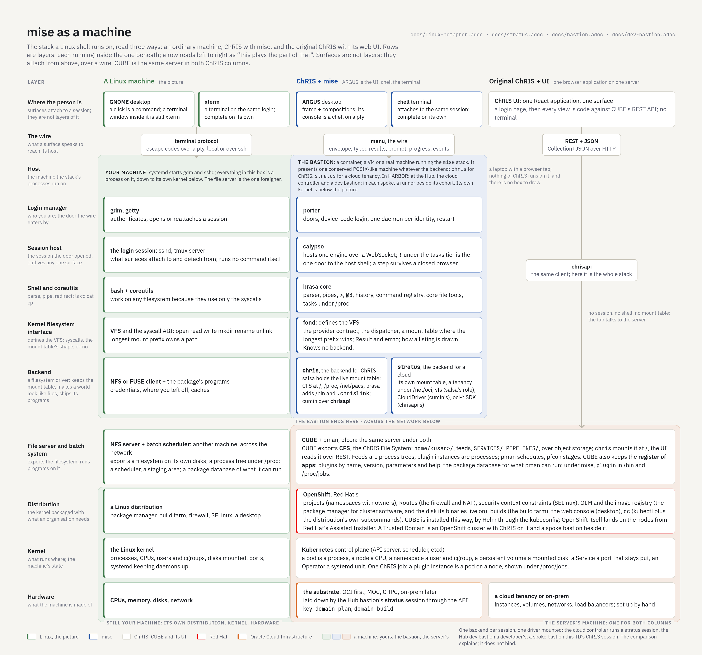

= mise as a Linux machine
Rudolph Pienaar <rudolph.pienaar@gmail.com>
:doctype: article
:toc: left
:toclevels: 2
:icons: font

[abstract]
== Abstract

mise is a shell, so the plainest way to hold its layers in mind is the machine a shell runs on. This note maps every mise package onto an ordinary Linux machine, then follows the picture down (CUBE, the jobs it runs, and the OpenShift and Kubernetes cluster under them) and out to the people looking at it (the original ChRIS UI and ARGUS). The machine the mise stack runs on is a *bastion*, a container, a VM or a real host, and HARBOR has three of them, one shape with different contents (link:bastion.adoc[bastion.adoc]). It explains; it does not bind. The design itself is in link:backend-neutral.adoc[backend-neutral.adoc], the substrate backend in link:stratus.adoc[stratus.adoc], and the rules in link:principles.adoc[principles.adoc].

[[machine]]
== The machine

The figure reads three ways at once. Rows are layers, each running inside the one beneath: the host holds the login manager, the login manager opens the session, the session runs the shell, the shell calls the kernel's filesystem interface, and that interface mounts a backend. A row reads left to right as "this plays the part of that". Surfaces are not layers: a desktop or a terminal attaches to a session from outside, over a wire, so they sit above every box, joined to it by the one edge that really exists, labelled with the protocol it speaks. The bastion's box ends at its backend; what the backend talks to is another machine, across the network, and the lower rows are that machine's distribution, kernel and hardware. On Linux the shell and the kernel share a box and the file server is the one foreigner; in HARBOR the shell lives in a container whose own kernel is below the picture, and the big machine on the page is the server's.

The table follows the figure's order, top down.

[cols="1,2,3",options="header"]
|===
| mise | Linux | What the comparison says

| The bastion
| The machine: `systemd` starts `gdm` and `sshd`; everything above its kernel is a process on it
| A container, a VM or a real host running the mise stack; its entrypoint starts `porter`. It presents one conserved POSIX-like machine whatever the backend. In HARBOR there are three: the cloud controller and a dev bastion at the Hub, and a runner beside its cohort in each spoke (link:bastion.adoc[bastion.adoc], link:dev-bastion.adoc[dev-bastion.adoc]). Its own kernel is below the picture.

| `porter`
| The login manager (`gdm`, `getty`)
| It authenticates the user and opens, or reattaches, their session. It is the door the wire enters by, and the only one: the host has no door of its own.

| `calypso`
| The login session; `sshd`, or a `tmux` server
| The session the door opened. It hosts the running engine and lets surfaces attach and detach; the session outlives any one of them. It runs no command itself. `!` under the `tasks` tier is the one way from a session to the host's shell.

| `brasa` core
| `bash` and coreutils
| The shell (parsing, pipes, `>`, `${vars}`, `cd -`, history) and the standard tools (`ls`, `cd`, `pwd`, `cat`, `cp`, `mv`, `rm`, `mkdir`, `rmdir`, `touch`, `help`, the games). They work on any filesystem because they use only the syscalls. The shell's own state lives in the shell: the working directory and the one before it, the last answer and what `@3` refers to, the command registry.

| `fond`
| The kernel's filesystem interface: the syscalls (`open`, `read`, `write`, `mkdir`, `rename`, `unlink`) and the shape of the mount table
| It *defines* the VFS and never fills it: the provider contract any filesystem must answer, the dispatcher (a mount table where the longest mount prefix owns a path and a path nothing claims goes to the root filesystem), and the house rules every program follows, how a failure is reported (`Result` and the error stack, like `errno`) and how `ls` draws a listing. It knows no backend.

| A backend: `chris`, `stratus`
| A filesystem driver, with the programs that come with it
| It *keeps* the live mount table, makes its world look like files, and installs programs that only make sense there. It holds its own state: credentials, where the user left off, its caches. `chris` is the backend for ChRIS; `stratus` is the backend for a cloud tenancy, with the cloud as a driver inside it (link:stratus.adoc[stratus.adoc]).

| `salsa` (in `chris`)
| The driver: an NFS or FUSE client for CUBE, and the machine's `fstab`
| It holds the `chris` mount table and fills it: CFS, the ChRIS File System CUBE exports, at `/`; `/proc` for CUBE's jobs; `/net/pacs`. CUBE's feeds, files, plugins, jobs and PACS, presented as a tree; it answers the syscalls for every path under it. `brasa`'s ChRIS code adds `/bin` and the resolution of `.chrislink` folders to the physical path CUBE stores.

| `cumin` and `chrisapi` (in `chris`)
| The driver's network client and login
| The connection to CUBE, the identity's credentials and saved context, and the caches that keep a slow server from being asked twice. `stratus` has the same three roles under other names: its `vfs/` providers play `salsa`, `CloudDriver` and its OCI implementation play `cumin`, Oracle's `oci-*` SDK plays `chrisapi`.

| The ChRIS commands (`feed`, `plugin`, `pacs`, `gather`, `upload`, ...)
| Programs the driver's package installs in `/bin`
| They make sense only on CUBE, and only a ChRIS session has them. `/bin` itself lists CUBE's plugins and pipelines, as executables.
|===

[[surfaces-attach]]
=== Surfaces attach; they are not layers

`chell` and ARGUS are to the session what an `xterm` and a GNOME desktop are to a login: two complete ways to look at, and type into, the same thing, neither a wrapper around the other. A terminal window inside GNOME is still `xterm`; the ARGUS console is still a `chell` on a pty. Neither runs inside the session's process, and neither need be on the host, which is why they sit above the machine's box in the figure rather than in it.

What joins a surface to its session is the wire, and each column speaks its own: Linux, the terminal protocol over a pty, local or over `ssh`; mise, `menu`, the envelope (a command's output, its exit status, its typed result), the prompt, the progress line, the events, the sink and surface interfaces; the original ChRIS UI, REST and JSON over HTTP. A surface that speaks the wire needs nothing else from the machine. The wire is the ABI between the person and the session; the ABI between the shell and the kernel is `fond`'s contract, a different seam at a different height, which is why `menu` is drawn above the shell and `fond` below it.

One backend per session reads as one driver mounted per machine: a ChRIS session is a machine whose filesystem is CUBE; a stratus session is another machine, with another driver. The three bastions are three such machines: the cloud controller runs a stratus session, the Hub dev bastion a developer's, a spoke bastion that Trusted Domain's ChRIS session.

[[bypass]]
== Tools that bypass the syscalls

The comparison makes one piece of debt easy to see. `chili` is an older set of tools that talk straight to the file server instead of going through the syscalls. Most of the file tools (`cat`, `mv`, `rm`, `mkdir`, `touch`) reach CUBE through it, so the driver only ever learned the two calls something used: `list` and `cp`. A coreutils that bypasses the kernel cannot run on another filesystem, and a driver nobody calls never learns the rest of the interface.

The repair is the ordinary one: coreutils use the syscalls, and the driver implements them (`read`, `write`, `mkdir`, `rmdir`, `rename`, `unlink`), calling the same CUBE operations the old tools did. What `chili` held that only CUBE needs goes to the driver (`salsa`) or to the ChRIS programs (`brasa`'s `chris/`); what any machine needs, like the way a listing is drawn, goes to the kernel's house rules (`fond`).

[[down]]
== Down the stack: CUBE, its jobs, and the cluster under them

The driver talks to a server, and the server has a machine of its own. The bastion's box ends at its backend; everything in this section is on the other side of the network, and in the figure it is one box under both ChRIS columns, because CUBE is the same server whether mise or the original UI is looking at it.

* *CUBE is the file server and the batch system together.* It exports a filesystem, CFS, the ChRIS File System: `home/<user>/`, the feeds under it, `SERVICES/`, `PIPELINES/`, kept in object storage behind CUBE and served through its REST endpoints; `chris` mounts it at `/`, the UI reads it over REST. And it runs programs on those files: a plugin instance is a process, a feed is a process tree, a pipeline is a script that starts several. mise shows those processes where Linux shows processes: under `/proc` (`/proc/jobs`), with their states, their children and their output.
* *CUBE is also the register of apps.* Plugins by name, version, parameters and help: the package database for what pman can run. Under mise it is `plugin` in `/bin`; under the UI it is the REST API the tab calls.
* *pman and pfcon are the scheduler and the staging area.* pman hands a job to whatever compute is attached and watches it; pfcon moves the job's inputs to where it runs and its outputs back. Together they play the part of a batch scheduler with network storage.
* *The compute is a Kubernetes cluster, usually OpenShift.* There, each job really is a process: a container in a pod, on some node.

Kubernetes reads naturally as an operating system for a whole cluster:

[cols="1,2",options="header"]
|===
| Kubernetes | Linux

| The control plane (API server, scheduler, `etcd`)
| The kernel: it decides what runs where, and keeps the machine's state

| A pod
| A process (a container: a process with its own root filesystem and limits)

| A node
| A CPU, with its share of memory

| A namespace
| A user and a control group: a boundary for names, quotas and permissions

| A persistent volume (claim)
| A disk, mounted where a process asks for it

| A Service
| A port that stays put while the processes behind it come and go

| A controller or an Operator
| A daemon that keeps something running the way it was declared (`systemd`)

| `kubectl`
| The administrator's shell to that kernel
|===

OpenShift is to Kubernetes what a distribution is to the Linux kernel: the same kernel, packaged with what an organisation needs around it. A *project* is a namespace with an owner; a *Route* is the firewall and NAT that let the outside reach a Service; *security context constraints* are its SELinux; OLM and the image registry are its package manager for cluster software and the disk those binaries live on; builds are its build farm; the web console is its desktop; `oc` is `kubectl` with the distribution's own subcommands. CUBE is installed this way, by Helm through the cluster's kubeconfig; OpenShift itself lands on the nodes from Red Hat's Assisted Installer, not from the tool that laid the nodes. Under the distribution is the hardware: the substrate, Oracle Cloud Infrastructure first, laid down by the Hub bastion's stratus session through the API key (`domain plan`, `domain build`). A Trusted Domain is an OpenShift cluster with ChRIS on it and a spoke bastion beside it.

So one ChRIS job, from the top: a user types a plugin's name in chell; the `chris` backend asks CUBE to run it; pman asks OpenShift for a pod; the pod is a process on a node; and mise shows that process under `/proc/jobs`, as Linux shows a process under `/proc`.

[[second-backend]]
=== The substrate as a machine of its own

The second backend, `stratus`, turns this around. Its tree is the cloud tenancy under `/net/oci`, with each Trusted Domain a folder under `domains/` and the cluster under its domain, itself a tree: projects as folders; deployments, pods and routes as entries in them. `terraform`, `oc` and `helm` are programs on the bastion's host that its build steps run through the supervised runner. It needs no CUBE at all: it is the console for building the machine a CUBE is deployed onto, and it runs on the Hub bastion, outside every tenancy it builds. The same shell and the same coreutils run on it, because they ask only for the syscalls; `ls` lists a tenancy the way it lists a feed. The whole of it is link:stratus.adoc[stratus.adoc]; where its host sits and what it holds is link:bastion.adoc[bastion.adoc].

[[surfaces]]
== Out to the screen: the original ChRIS UI and ARGUS

*The original ChRIS UI is a vendor's web console for one appliance.* It is a browser application that speaks CUBE's REST API directly, through the `chrisapi` client: it shows CUBE's feeds, files and plugins in views written for them, and it is the right tool for what it covers. It has no shell under it, so nothing it does can be typed, piped, scripted or seen from a terminal, and a terminal's work is invisible to it. In the figure its column has no box: a login page and one application in a tab, a wire straight down to CUBE, and nothing of ChRIS on the laptop. Each new view is new code against the server's API, much as a NAS's web panel knows only that NAS.

*ARGUS is a desktop session on the machine.* It attaches to the same session a terminal does (through `calypso`, like a desktop reconnecting to a running login), so its terminal pane and its graphical panes are two views of one session. A pane is a graphical program over the same files and the same processes: the feed graph is a system monitor drawn from `/proc`, the file pane is a file manager over the same tree `ls` lists, and a click and a typed command are the same operation, with the same result and the same numbering. The frame is backend-neutral, like a desktop environment; the panes that know CUBE are the ChRIS backend's applications, installed beside it.

[cols="1,2,2",options="header"]
|===
| | Original ChRIS UI | ARGUS

| Talks to
| CUBE's REST API, directly
| The session, through `calypso`, over `menu`

| A view is
| Code written against one server's API
| A program over the session's files and processes

| A terminal's work
| Invisible to it
| The same session: what one does, the other sees

| On another backend
| Rewritten
| The frame stays; that backend brings its own applications
|===

[[limits]]
== Where the comparison stops

* A real kernel mounts many filesystems at once; a mise session has one backend, by design, so one process never holds two kinds of credentials (link:backend-neutral.adoc#security[backend-neutral.adoc]). The three bastions keep three disjoint key rings for the same reason.
* A Linux program writes bytes; a mise command returns an envelope that carries a typed model as well as text, which is how a graphical pane draws the same answer a terminal prints.
* CUBE is a server across a network, not a disk. A listing can be minutes old or minutes away, which is why the driver keeps caches and why mise says when it serves one.
* A Linux machine's box holds its own kernel; the bastion's does not. The bastion is a container, and its distribution, kernel and hardware (an image, a pod, a node on the Hub cluster) are below the picture; the distribution, kernel and hardware the figure draws are the server's.
